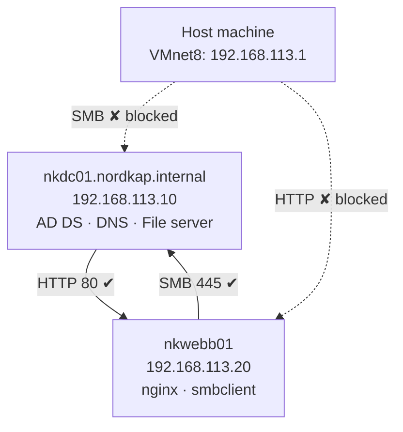

# Nordkap Konsult AB: building an IT environment from scratch

> School assignment in the IT Security Specialist program (class ITS26G), autumn 2026.
> I built, hardened and documented a small company environment with a Windows domain controller
> and a Linux web server in VMware Workstation. The fictional company is *Nordkap Konsult AB*.

## Contents

| File | What it covers |
|---|---|
| [part-a-windows-server.md](part-a-windows-server.md) | Active Directory, OU structure, users, groups, file share, NTFS, firewall, auditing, Defender |
| [part-b-ubuntu-server.md](part-b-ubuntu-server.md) | nginx, Linux permissions with setgid, ufw, smbclient against the Windows share |
| [part-c-scripting.md](part-c-scripting.md) | Bash + regex to analyze the nginx log, a PowerShell script that monitors services |
| [troubleshooting-log.md](troubleshooting-log.md) | Every problem I ran into: symptom, cause and fix |
| [lessons-learned.md](lessons-learned.md) | The most important takeaways |
| [scripts/](scripts/) | The finished scripts |

## The environment

| Machine | Role | IP | OS |
|---|---|---|---|
| **nkdc01** | Domain controller (AD DS, DNS, GC) and file server | 192.168.113.10 | Windows Server 2025 Standard Evaluation, 24H2 |
| **nkwebb01** | Web server (nginx) and SMB client | 192.168.113.20 | Ubuntu Server 26.04.1 LTS |

- Network: VMware **VMnet8 (NAT)**, 192.168.113.0/24, gateway 192.168.113.2
- DHCP range .128–.254. Both servers have static addresses outside the range.
- Domain: `nordkap.internal`

The principle throughout the build: **close everything, open only what is needed, and only for whoever needs it.**

## Tools
VMware Workstation · Windows Server 2025 · Active Directory Users and Computers · Windows Defender Firewall with Advanced Security · secpol.msc / auditpol · Event Viewer · Task Scheduler · PowerShell · Ubuntu Server · nginx · ufw · smbclient · vim/nano · bash, grep, sed
